# Chapter One — Database Schema Reference

Auto-generated from live introspection of the `public` schema (database `Chapter_One`, PostgreSQL).

> Regenerate by connecting via the `pg` package with `DATABASE_URL` from `.env` and re-running the introspection queries (information_schema + pg_catalog). Do not hand-edit — treat this as a snapshot.

## Table of Contents

- [Enums](#enums)
- [Sequences](#sequences)
- [Tables](#tables)
  - [analytics_settings](#analytics-settings)
  - [app_users](#app-users)
  - [authors](#authors)
  - [book_authors](#book-authors)
  - [book_categories](#book-categories)
  - [books](#books)
  - [categories](#categories)
  - [customers](#customers)
  - [daily_receipt_counters](#daily-receipt-counters)
  - [day_closures](#day-closures)
  - [dispose_reasons](#dispose-reasons)
  - [expense_categories](#expense-categories)
  - [expenses](#expenses)
  - [licenses](#licenses)
  - [migrations](#migrations)
  - [notification_prefs](#notification-prefs)
  - [opening_stock_items](#opening-stock-items)
  - [opening_stock_sessions](#opening-stock-sessions)
  - [orders](#orders)
  - [product_books](#product-books)
  - [product_types](#product-types)
  - [products](#products)
  - [publishers](#publishers)
  - [purchase_order_items](#purchase-order-items)
  - [purchase_orders](#purchase-orders)
  - [restaurant_menus](#restaurant-menus)
  - [restaurant_sale_context](#restaurant-sale-context)
  - [restaurant_table_sessions](#restaurant-table-sessions)
  - [sale_items](#sale-items)
  - [sale_payments](#sale-payments)
  - [sales](#sales)
  - [scale_barcode_formats](#scale-barcode-formats)
  - [scale_devices](#scale-devices)
  - [stock_balances](#stock-balances)
  - [stock_disposal_items](#stock-disposal-items)
  - [stock_disposals](#stock-disposals)
  - [stock_movements](#stock-movements)
  - [store_settings](#store-settings)
  - [stores](#stores)
  - [suppliers](#suppliers)
  - [system_backups](#system-backups)
  - [system_logs](#system-logs)
  - [terminals](#terminals)
- [Views](#views)
- [Entity Relationship Map](#entity-relationship-map)
- [Migration Audit — Known Discrepancies](#migration-audit--known-discrepancies)

---

## Enums

- **movement_reason**: `purchase`, `sale`, `return_in`, `return_out`, `adjustment_pos`, `adjustment_neg`, `transfer_in`, `transfer_out`, `damage`, `theft`, `adjustment`, `return`, `cancelled`, `opening_stock`, `disposed`
- **payment_method**: `cash`, `card`, `voucher`, `mixed`, `other`
- **sale_status**: `open`, `paid`, `void`, `refunded`, `cancelled`

---

## Sequences

| Sequence | Data Type | Start | Increment |
|---|---|---|---|
| day_closures_id_seq | integer | 1 | 1 |
| dispose_reasons_reason_id_seq | integer | 1 | 1 |
| expense_categories_category_id_seq | integer | 1 | 1 |
| migrations_id_seq | integer | 1 | 1 |
| orders_id_seq | integer | 1 | 1 |

---

## Tables

43 base tables in the `public` schema.

### analytics_settings

| Column | Type | Nullable | Default | Key |
|---|---|---|---|---|
| store_id | uuid | NOT NULL | — | PK, FK→stores.store_id |
| sales | boolean | NOT NULL | `true` | — |
| inventory | boolean | NOT NULL | `true` | — |
| customers | boolean | NOT NULL | `false` | — |
| performance | boolean | NOT NULL | `true` | — |
| report_frequency | text | NOT NULL | `'weekly'::text` | — |
| retention | text | NOT NULL | `'6months'::text` | — |
| auto_reports | boolean | nullable | `false` | — |
| created_at | timestamp with time zone | NOT NULL | `now()` | — |
| updated_at | timestamp with time zone | NOT NULL | `now()` | — |

**Primary Key:** analytics_settings_pkey (store_id)

**Foreign Keys (outgoing):**
- `store_id` → `stores.store_id` (analytics_settings_store_id_fkey; ON UPDATE NO ACTION, ON DELETE CASCADE)

**Check Constraints:**
- analytics_settings_report_frequency_check: `(report_frequency = ANY (ARRAY['daily'::text, 'weekly'::text, 'monthly'::text]))`
- analytics_settings_retention_check: `(retention = ANY (ARRAY['3months'::text, '6months'::text, '1year'::text, '2years'::text]))`

**Indexes:**
- analytics_settings_pkey (primary key index): `CREATE UNIQUE INDEX analytics_settings_pkey ON public.analytics_settings USING btree (store_id)`

**Triggers:**
- trg_analytics_settings_updated_at: BEFORE UPDATE — EXECUTE FUNCTION update_updated_at_column()

---

### app_users

| Column | Type | Nullable | Default | Key |
|---|---|---|---|---|
| user_id | uuid | NOT NULL | `gen_random_uuid()` | PK |
| username | text | NOT NULL | — | UQ |
| full_name | text | NOT NULL | — | — |
| role | text | NOT NULL | — | — |
| password_hash | text | NOT NULL | — | — |
| is_active | boolean | NOT NULL | `true` | — |
| created_at | timestamp with time zone | NOT NULL | `now()` | — |

**Primary Key:** app_users_pkey (user_id)

**Referenced by (incoming):**
- `day_closures.closed_by` → this.user_id
- `expenses.created_by` → this.user_id
- `opening_stock_sessions.committed_by` → this.user_id
- `opening_stock_sessions.created_by` → this.user_id
- `restaurant_table_sessions.cashier_id` → this.user_id
- `sales.cashier_id` → this.user_id
- `stock_disposals.disposed_by` → this.user_id
- `stock_movements.created_by` → this.user_id
- `system_backups.created_by` → this.user_id
- `system_logs.user_id` → this.user_id

**Unique Constraints:**
- app_users_username_key (username)

**Check Constraints:**
- app_users_role_check: `(role = ANY (ARRAY['cashier'::text, 'manager'::text, 'admin'::text, 'self_checkout'::text]))`

**Indexes:**
- app_users_pkey (primary key index): `CREATE UNIQUE INDEX app_users_pkey ON public.app_users USING btree (user_id)`
- app_users_username_key (unique): `CREATE UNIQUE INDEX app_users_username_key ON public.app_users USING btree (username)`

---

### authors

| Column | Type | Nullable | Default | Key |
|---|---|---|---|---|
| author_id | uuid | NOT NULL | `gen_random_uuid()` | PK |
| name | text | NOT NULL | — | — |

**Primary Key:** authors_pkey (author_id)

**Referenced by (incoming):**
- `book_authors.author_id` → this.author_id

**Indexes:**
- authors_pkey (primary key index): `CREATE UNIQUE INDEX authors_pkey ON public.authors USING btree (author_id)`

---

### book_authors

| Column | Type | Nullable | Default | Key |
|---|---|---|---|---|
| book_id | uuid | NOT NULL | — | PK, FK→books.book_id |
| author_id | uuid | NOT NULL | — | PK, FK→authors.author_id |
| ord | integer | NOT NULL | `1` | — |

**Primary Key:** book_authors_pkey (book_id, author_id)

**Foreign Keys (outgoing):**
- `book_id` → `books.book_id` (book_authors_book_id_fkey; ON UPDATE NO ACTION, ON DELETE CASCADE)
- `author_id` → `authors.author_id` (book_authors_author_id_fkey; ON UPDATE NO ACTION, ON DELETE CASCADE)

**Indexes:**
- book_authors_pkey (primary key index): `CREATE UNIQUE INDEX book_authors_pkey ON public.book_authors USING btree (book_id, author_id)`

---

### book_categories

| Column | Type | Nullable | Default | Key |
|---|---|---|---|---|
| book_id | uuid | NOT NULL | — | PK, FK→books.book_id |
| category_id | uuid | NOT NULL | — | PK, FK→categories.category_id |

**Primary Key:** book_categories_pkey (book_id, category_id)

**Foreign Keys (outgoing):**
- `category_id` → `categories.category_id` (book_categories_category_id_fkey; ON UPDATE NO ACTION, ON DELETE CASCADE)
- `book_id` → `books.book_id` (book_categories_book_id_fkey; ON UPDATE NO ACTION, ON DELETE CASCADE)

**Indexes:**
- book_categories_pkey (primary key index): `CREATE UNIQUE INDEX book_categories_pkey ON public.book_categories USING btree (book_id, category_id)`

---

### books

| Column | Type | Nullable | Default | Key |
|---|---|---|---|---|
| book_id | uuid | NOT NULL | `gen_random_uuid()` | PK |
| isbn13 | text | nullable | — | — |
| title | text | NOT NULL | — | — |
| subtitle | text | nullable | — | — |
| publisher_id | uuid | nullable | — | FK→publishers.publisher_id |
| publish_year | integer | nullable | — | — |
| edition | text | nullable | — | — |
| language | text | nullable | — | — |
| list_price | numeric(12,2) | NOT NULL | `0` | — |
| sale_price | numeric(12,2) | nullable | — | — |
| tax_rate | numeric(5,2) | NOT NULL | `0` | — |
| barcode | text | nullable | — | — |
| sku | text | nullable | — | — |
| track_inventory | boolean | NOT NULL | `true` | — |
| created_at | timestamp with time zone | NOT NULL | `now()` | — |
| updated_at | timestamp with time zone | NOT NULL | `now()` | — |

**Primary Key:** books_pkey (book_id)

**Foreign Keys (outgoing):**
- `publisher_id` → `publishers.publisher_id` (books_publisher_id_fkey; ON UPDATE NO ACTION, ON DELETE SET NULL)

**Referenced by (incoming):**
- `book_authors.book_id` → this.book_id
- `book_categories.book_id` → this.book_id
- `product_books.book_id` → this.book_id

**Indexes:**
- books_pkey (primary key index): `CREATE UNIQUE INDEX books_pkey ON public.books USING btree (book_id)`

**Triggers:**
- trg_books_updated_at: BEFORE UPDATE — EXECUTE FUNCTION update_updated_at_column()

---

### categories

| Column | Type | Nullable | Default | Key |
|---|---|---|---|---|
| category_id | uuid | NOT NULL | `gen_random_uuid()` | PK |
| name | text | NOT NULL | — | — |
| parent_id | uuid | nullable | — | FK→categories.category_id |

**Primary Key:** categories_pkey (category_id)

**Foreign Keys (outgoing):**
- `parent_id` → `categories.category_id` (categories_parent_id_fkey; ON UPDATE NO ACTION, ON DELETE SET NULL)

**Referenced by (incoming):**
- `book_categories.category_id` → this.category_id
- `categories.parent_id` → this.category_id

**Indexes:**
- categories_pkey (primary key index): `CREATE UNIQUE INDEX categories_pkey ON public.categories USING btree (category_id)`

---

### customers

| Column | Type | Nullable | Default | Key |
|---|---|---|---|---|
| customer_id | uuid | NOT NULL | `gen_random_uuid()` | PK |
| full_name | text | nullable | — | — |
| phone | text | nullable | — | — |
| email | text | nullable | — | — |
| notes | text | nullable | — | — |
| total_orders | integer | nullable | `0` | — |
| total_spent | numeric(10,2) | nullable | `0.00` | — |
| last_order | timestamp without time zone | nullable | — | — |
| created_at | timestamp with time zone | NOT NULL | `now()` | — |
| updated_at | timestamp without time zone | nullable | `CURRENT_TIMESTAMP` | — |

**Primary Key:** customers_pkey (customer_id)

**Referenced by (incoming):**
- `sales.customer_id` → this.customer_id

**Indexes:**
- customers_pkey (primary key index): `CREATE UNIQUE INDEX customers_pkey ON public.customers USING btree (customer_id)`

**Triggers:**
- trg_customers_updated_at: BEFORE UPDATE — EXECUTE FUNCTION update_updated_at_column()

---

### daily_receipt_counters

| Column | Type | Nullable | Default | Key |
|---|---|---|---|---|
| store_id | uuid | NOT NULL | — | PK, FK→stores.store_id |
| date | date | NOT NULL | — | PK |
| counter | integer | NOT NULL | `0` | — |
| created_at | timestamp without time zone | NOT NULL | `now()` | — |
| updated_at | timestamp without time zone | NOT NULL | `now()` | — |

**Primary Key:** daily_receipt_counters_pkey (store_id, date)

**Foreign Keys (outgoing):**
- `store_id` → `stores.store_id` (daily_receipt_counters_store_id_fkey; ON UPDATE NO ACTION, ON DELETE CASCADE)

**Indexes:**
- daily_receipt_counters_pkey (primary key index): `CREATE UNIQUE INDEX daily_receipt_counters_pkey ON public.daily_receipt_counters USING btree (store_id, date)`
- idx_daily_receipt_counters_store_date: `CREATE INDEX idx_daily_receipt_counters_store_date ON public.daily_receipt_counters USING btree (store_id, date)`

---

### day_closures

| Column | Type | Nullable | Default | Key |
|---|---|---|---|---|
| id | integer | NOT NULL | `nextval('day_closures_id_seq'::regclass)` | PK |
| store_id | uuid | NOT NULL | — | FK→stores.store_id, UQ |
| closure_date | date | NOT NULL | `((CURRENT_TIMESTAMP AT TIME ZONE 'UTC'::text))::date` | — |
| total_sales | numeric(12,2) | NOT NULL | `0` | — |
| total_transactions | integer | NOT NULL | `0` | — |
| cash_expected | numeric(12,2) | NOT NULL | `0` | — |
| cash_actual | numeric(12,2) | nullable | — | — |
| cash_difference | numeric(12,2) | nullable | — | — |
| card_total | numeric(12,2) | NOT NULL | `0` | — |
| other_payments | numeric(12,2) | NOT NULL | `0` | — |
| closed_by | uuid | NOT NULL | — | FK→app_users.user_id |
| closed_at | timestamp with time zone | NOT NULL | `now()` | — |
| z_number | integer | NOT NULL | — | UQ |
| notes | text | nullable | — | — |
| created_at | timestamp with time zone | NOT NULL | `now()` | — |
| cash_breakdown | jsonb | nullable | — | — |
| total_expenses | numeric(12,2) | NOT NULL | `0` | — |
| opening_float | numeric(12,2) | NOT NULL | `0` | — |
| opening_float_breakdown | jsonb | nullable | — | — |
| cash_left_in_drawer | numeric(12,2) | NOT NULL | `0` | — |
| cash_left_in_drawer_breakdown | jsonb | nullable | — | — |
| cash_to_bank | numeric(12,2) | NOT NULL | `0` | — |

**Primary Key:** day_closures_pkey (id)

**Foreign Keys (outgoing):**
- `closed_by` → `app_users.user_id` (day_closures_closed_by_fkey; ON UPDATE NO ACTION, ON DELETE RESTRICT)
- `store_id` → `stores.store_id` (day_closures_store_id_fkey; ON UPDATE NO ACTION, ON DELETE RESTRICT)

**Referenced by (incoming):**
- `expenses.day_closure_id` → this.id
- `sales.day_closure_id` → this.id

**Unique Constraints:**
- day_closures_store_id_z_number_key (store_id, z_number)

**Indexes:**
- day_closures_pkey (primary key index): `CREATE UNIQUE INDEX day_closures_pkey ON public.day_closures USING btree (id)`
- day_closures_store_id_z_number_key (unique): `CREATE UNIQUE INDEX day_closures_store_id_z_number_key ON public.day_closures USING btree (store_id, z_number)`
- idx_day_closures_store_closed_at: `CREATE INDEX idx_day_closures_store_closed_at ON public.day_closures USING btree (store_id, closed_at DESC)`

---

### dispose_reasons

| Column | Type | Nullable | Default | Key |
|---|---|---|---|---|
| reason_id | integer | NOT NULL | `nextval('dispose_reasons_reason_id_seq'::regclass)` | PK |
| store_id | uuid | nullable | — | FK→stores.store_id |
| name | character varying(100) | NOT NULL | — | — |
| is_system | boolean | NOT NULL | `false` | — |
| sort_order | integer | NOT NULL | `100` | — |
| created_at | timestamp with time zone | NOT NULL | `now()` | — |

**Primary Key:** dispose_reasons_pkey (reason_id)

**Foreign Keys (outgoing):**
- `store_id` → `stores.store_id` (dispose_reasons_store_id_fkey; ON UPDATE NO ACTION, ON DELETE CASCADE)

**Referenced by (incoming):**
- `stock_disposal_items.reason_id` → this.reason_id

**Indexes:**
- dispose_reasons_pkey (primary key index): `CREATE UNIQUE INDEX dispose_reasons_pkey ON public.dispose_reasons USING btree (reason_id)`
- idx_dispose_reasons_store: `CREATE INDEX idx_dispose_reasons_store ON public.dispose_reasons USING btree (store_id)`
- uq_dispose_reason_global_name (unique): `CREATE UNIQUE INDEX uq_dispose_reason_global_name ON public.dispose_reasons USING btree (name) WHERE (store_id IS NULL)`
- uq_dispose_reason_store_name (unique): `CREATE UNIQUE INDEX uq_dispose_reason_store_name ON public.dispose_reasons USING btree (store_id, name) WHERE (store_id IS NOT NULL)`

---

### expense_categories

| Column | Type | Nullable | Default | Key |
|---|---|---|---|---|
| category_id | integer | NOT NULL | `nextval('expense_categories_category_id_seq'::regclass)` | PK |
| store_id | uuid | nullable | — | FK→stores.store_id |
| name | character varying(100) | NOT NULL | — | — |
| is_system | boolean | NOT NULL | `false` | — |
| sort_order | integer | NOT NULL | `100` | — |
| created_at | timestamp with time zone | NOT NULL | `now()` | — |

**Primary Key:** expense_categories_pkey (category_id)

**Foreign Keys (outgoing):**
- `store_id` → `stores.store_id` (expense_categories_store_id_fkey; ON UPDATE NO ACTION, ON DELETE CASCADE)

**Referenced by (incoming):**
- `expenses.category_id` → this.category_id

**Indexes:**
- expense_categories_pkey (primary key index): `CREATE UNIQUE INDEX expense_categories_pkey ON public.expense_categories USING btree (category_id)`
- idx_expense_categories_store: `CREATE INDEX idx_expense_categories_store ON public.expense_categories USING btree (store_id)`
- uq_expense_cat_global_name (unique): `CREATE UNIQUE INDEX uq_expense_cat_global_name ON public.expense_categories USING btree (name) WHERE (store_id IS NULL)`
- uq_expense_cat_store_name (unique): `CREATE UNIQUE INDEX uq_expense_cat_store_name ON public.expense_categories USING btree (store_id, name) WHERE (store_id IS NOT NULL)`

---

### expenses

| Column | Type | Nullable | Default | Key |
|---|---|---|---|---|
| expense_id | uuid | NOT NULL | `gen_random_uuid()` | PK |
| store_id | uuid | NOT NULL | — | FK→stores.store_id |
| category_id | integer | NOT NULL | — | FK→expense_categories.category_id |
| amount | numeric(12,2) | NOT NULL | — | — |
| description | text | nullable | — | — |
| expense_date | date | NOT NULL | `CURRENT_DATE` | — |
| day_closure_id | integer | nullable | — | FK→day_closures.id |
| created_by | uuid | nullable | — | FK→app_users.user_id |
| created_at | timestamp with time zone | NOT NULL | `now()` | — |

**Primary Key:** expenses_pkey (expense_id)

**Foreign Keys (outgoing):**
- `day_closure_id` → `day_closures.id` (expenses_day_closure_id_fkey; ON UPDATE NO ACTION, ON DELETE SET NULL)
- `category_id` → `expense_categories.category_id` (expenses_category_id_fkey; ON UPDATE NO ACTION, ON DELETE NO ACTION)
- `store_id` → `stores.store_id` (expenses_store_id_fkey; ON UPDATE NO ACTION, ON DELETE CASCADE)
- `created_by` → `app_users.user_id` (expenses_created_by_fkey; ON UPDATE NO ACTION, ON DELETE NO ACTION)

**Check Constraints:**
- expenses_amount_check: `(amount > (0)::numeric)`

**Indexes:**
- expenses_pkey (primary key index): `CREATE UNIQUE INDEX expenses_pkey ON public.expenses USING btree (expense_id)`
- idx_expenses_store_date: `CREATE INDEX idx_expenses_store_date ON public.expenses USING btree (store_id, expense_date DESC)`
- idx_expenses_unclosed: `CREATE INDEX idx_expenses_unclosed ON public.expenses USING btree (store_id, day_closure_id) WHERE (day_closure_id IS NULL)`

---

### licenses

| Column | Type | Nullable | Default | Key |
|---|---|---|---|---|
| license_id | uuid | NOT NULL | `gen_random_uuid()` | PK |
| store_id | uuid | NOT NULL | — | FK→stores.store_id, UQ |
| device_id | character varying(255) | nullable | — | — |
| installation_id | character varying(255) | nullable | — | — |
| convex_subscription_id | character varying(255) | nullable | — | — |
| convex_license_id | character varying(255) | nullable | — | — |
| license_prefix | character varying(50) | nullable | — | — |
| plan | character varying(50) | NOT NULL | — | — |
| status | character varying(50) | NOT NULL | `'active'::character varying` | — |
| valid_from | timestamp without time zone | NOT NULL | — | — |
| valid_until | timestamp without time zone | NOT NULL | — | — |
| activated_at | timestamp without time zone | NOT NULL | `now()` | — |
| customer_name | character varying(255) | nullable | — | — |
| customer_email | character varying(255) | nullable | — | — |
| company_name | character varying(255) | nullable | — | — |
| store_name | character varying(255) | nullable | — | — |
| license_payload_hash | text | nullable | — | — |
| created_at | timestamp without time zone | NOT NULL | `now()` | — |
| updated_at | timestamp without time zone | NOT NULL | `now()` | — |

**Primary Key:** licenses_pkey (license_id)

**Foreign Keys (outgoing):**
- `store_id` → `stores.store_id` (licenses_store_id_fkey; ON UPDATE NO ACTION, ON DELETE CASCADE)

**Unique Constraints:**
- licenses_store_id_unique (store_id)

**Indexes:**
- idx_licenses_installation_id: `CREATE INDEX idx_licenses_installation_id ON public.licenses USING btree (installation_id)`
- idx_licenses_status: `CREATE INDEX idx_licenses_status ON public.licenses USING btree (status)`
- idx_licenses_store_id: `CREATE INDEX idx_licenses_store_id ON public.licenses USING btree (store_id)`
- idx_licenses_valid_until: `CREATE INDEX idx_licenses_valid_until ON public.licenses USING btree (valid_until)`
- licenses_pkey (primary key index): `CREATE UNIQUE INDEX licenses_pkey ON public.licenses USING btree (license_id)`
- licenses_store_id_unique (unique): `CREATE UNIQUE INDEX licenses_store_id_unique ON public.licenses USING btree (store_id)`

**Triggers:**
- trg_licenses_updated_at: BEFORE UPDATE — EXECUTE FUNCTION update_updated_at_column()

---

### migrations

| Column | Type | Nullable | Default | Key |
|---|---|---|---|---|
| id | integer | NOT NULL | `nextval('migrations_id_seq'::regclass)` | PK |
| name | character varying(255) | NOT NULL | — | UQ |
| executed_at | timestamp with time zone | nullable | `CURRENT_TIMESTAMP` | — |

**Primary Key:** migrations_pkey (id)

**Unique Constraints:**
- migrations_name_key (name)

**Indexes:**
- migrations_name_key (unique): `CREATE UNIQUE INDEX migrations_name_key ON public.migrations USING btree (name)`
- migrations_pkey (primary key index): `CREATE UNIQUE INDEX migrations_pkey ON public.migrations USING btree (id)`

---

### notification_prefs

| Column | Type | Nullable | Default | Key |
|---|---|---|---|---|
| id | uuid | NOT NULL | `gen_random_uuid()` | PK |
| store_id | uuid | NOT NULL | — | FK→stores.store_id |
| type | text | NOT NULL | — | — |
| active | boolean | NOT NULL | `true` | — |
| frequency | text | NOT NULL | — | — |
| threshold_value | numeric(12,2) | nullable | — | — |
| created_at | timestamp with time zone | NOT NULL | `now()` | — |
| updated_at | timestamp with time zone | NOT NULL | `now()` | — |

**Primary Key:** notification_prefs_pkey (id)

**Foreign Keys (outgoing):**
- `store_id` → `stores.store_id` (notification_prefs_store_id_fkey; ON UPDATE NO ACTION, ON DELETE CASCADE)

**Check Constraints:**
- notification_prefs_frequency_check: `(frequency = ANY (ARRAY['immediate'::text, 'daily'::text, 'weekly'::text]))`
- notification_prefs_type_check: `(type = ANY (ARRAY['stock'::text, 'sales'::text, 'system'::text, 'backup'::text, 'reports'::text]))`

**Indexes:**
- notification_prefs_pkey (primary key index): `CREATE UNIQUE INDEX notification_prefs_pkey ON public.notification_prefs USING btree (id)`

**Triggers:**
- trg_notification_prefs_updated_at: BEFORE UPDATE — EXECUTE FUNCTION update_updated_at_column()

---

### opening_stock_items

| Column | Type | Nullable | Default | Key |
|---|---|---|---|---|
| item_id | uuid | NOT NULL | `gen_random_uuid()` | PK |
| session_id | uuid | NOT NULL | — | FK→opening_stock_sessions.session_id, UQ |
| product_id | uuid | NOT NULL | — | FK→products.product_id, UQ |
| qty | numeric(10,3) | NOT NULL | — | — |

**Primary Key:** opening_stock_items_pkey (item_id)

**Foreign Keys (outgoing):**
- `session_id` → `opening_stock_sessions.session_id` (opening_stock_items_session_id_fkey; ON UPDATE NO ACTION, ON DELETE CASCADE)
- `product_id` → `products.product_id` (opening_stock_items_product_id_fkey; ON UPDATE NO ACTION, ON DELETE CASCADE)

**Unique Constraints:**
- opening_stock_items_session_id_product_id_key (session_id, product_id)

**Check Constraints:**
- opening_stock_items_qty_check: `(qty > (0)::numeric)`

**Indexes:**
- idx_opening_stock_items_session: `CREATE INDEX idx_opening_stock_items_session ON public.opening_stock_items USING btree (session_id)`
- opening_stock_items_pkey (primary key index): `CREATE UNIQUE INDEX opening_stock_items_pkey ON public.opening_stock_items USING btree (item_id)`
- opening_stock_items_session_id_product_id_key (unique): `CREATE UNIQUE INDEX opening_stock_items_session_id_product_id_key ON public.opening_stock_items USING btree (session_id, product_id)`

---

### opening_stock_sessions

| Column | Type | Nullable | Default | Key |
|---|---|---|---|---|
| session_id | uuid | NOT NULL | `gen_random_uuid()` | PK |
| store_id | uuid | NOT NULL | — | FK→stores.store_id, UQ |
| reference | character varying(100) | NOT NULL | — | — |
| notes | text | nullable | — | — |
| status | character varying(20) | NOT NULL | `'draft'::character varying` | — |
| committed_at | timestamp with time zone | nullable | — | — |
| committed_by | uuid | nullable | — | FK→app_users.user_id |
| created_at | timestamp with time zone | NOT NULL | `now()` | — |
| created_by | uuid | nullable | — | FK→app_users.user_id |

**Primary Key:** opening_stock_sessions_pkey (session_id)

**Foreign Keys (outgoing):**
- `store_id` → `stores.store_id` (opening_stock_sessions_store_id_fkey; ON UPDATE NO ACTION, ON DELETE CASCADE)
- `committed_by` → `app_users.user_id` (opening_stock_sessions_committed_by_fkey; ON UPDATE NO ACTION, ON DELETE NO ACTION)
- `created_by` → `app_users.user_id` (opening_stock_sessions_created_by_fkey; ON UPDATE NO ACTION, ON DELETE NO ACTION)

**Referenced by (incoming):**
- `opening_stock_items.session_id` → this.session_id

**Unique Constraints:**
- opening_stock_sessions_store_id_key (store_id)

**Check Constraints:**
- opening_stock_sessions_status_check: `((status)::text = ANY ((ARRAY['draft'::character varying, 'committed'::character varying])::text[]))`

**Indexes:**
- idx_opening_stock_sessions_store: `CREATE INDEX idx_opening_stock_sessions_store ON public.opening_stock_sessions USING btree (store_id)`
- opening_stock_sessions_pkey (primary key index): `CREATE UNIQUE INDEX opening_stock_sessions_pkey ON public.opening_stock_sessions USING btree (session_id)`
- opening_stock_sessions_store_id_key (unique): `CREATE UNIQUE INDEX opening_stock_sessions_store_id_key ON public.opening_stock_sessions USING btree (store_id)`

---

### orders

| Column | Type | Nullable | Default | Key |
|---|---|---|---|---|
| id | integer | NOT NULL | `nextval('orders_id_seq'::regclass)` | PK |
| customer_id | integer | NOT NULL | — | — |
| total_amount | numeric(10,2) | NOT NULL | — | — |
| order_date | timestamp with time zone | nullable | `CURRENT_TIMESTAMP` | — |
| status | character varying(50) | nullable | `'pending'::character varying` | — |

**Primary Key:** orders_pkey (id)

**Indexes:**
- idx_orders_customer_id: `CREATE INDEX idx_orders_customer_id ON public.orders USING btree (customer_id)`
- orders_pkey (primary key index): `CREATE UNIQUE INDEX orders_pkey ON public.orders USING btree (id)`

---

### product_books

| Column | Type | Nullable | Default | Key |
|---|---|---|---|---|
| product_id | uuid | NOT NULL | — | PK, FK→products.product_id |
| book_id | uuid | nullable | — | FK→books.book_id |
| isbn13 | text | nullable | — | — |
| subtitle | text | nullable | — | — |
| publisher_id | uuid | nullable | — | FK→publishers.publisher_id |
| publish_year | integer | nullable | — | — |
| edition | text | nullable | — | — |
| language | text | nullable | — | — |

**Primary Key:** product_books_pkey (product_id)

**Foreign Keys (outgoing):**
- `publisher_id` → `publishers.publisher_id` (product_books_publisher_id_fkey; ON UPDATE NO ACTION, ON DELETE SET NULL)
- `product_id` → `products.product_id` (product_books_product_id_fkey; ON UPDATE NO ACTION, ON DELETE CASCADE)
- `book_id` → `books.book_id` (product_books_book_id_fkey; ON UPDATE NO ACTION, ON DELETE SET NULL)

**Indexes:**
- product_books_pkey (primary key index): `CREATE UNIQUE INDEX product_books_pkey ON public.product_books USING btree (product_id)`

---

### product_types

| Column | Type | Nullable | Default | Key |
|---|---|---|---|---|
| id | uuid | NOT NULL | `gen_random_uuid()` | PK |
| name | character varying(100) | NOT NULL | — | UQ |
| created_at | timestamp with time zone | nullable | `now()` | — |
| updated_at | timestamp with time zone | nullable | `now()` | — |
| display_on_pos | boolean | nullable | `false` | — |
| press_to_add | boolean | nullable | `false` | — |

**Primary Key:** product_types_pkey (id)

**Unique Constraints:**
- product_types_name_key (name)

**Indexes:**
- product_types_name_key (unique): `CREATE UNIQUE INDEX product_types_name_key ON public.product_types USING btree (name)`
- product_types_pkey (primary key index): `CREATE UNIQUE INDEX product_types_pkey ON public.product_types USING btree (id)`

---

### products

| Column | Type | Nullable | Default | Key |
|---|---|---|---|---|
| product_id | uuid | NOT NULL | `gen_random_uuid()` | PK |
| sku | text | nullable | — | UQ |
| barcode | text | nullable | — | UQ |
| name | text | NOT NULL | — | — |
| product_type | text | nullable | `'BOOK'::text` | — |
| list_price | numeric(12,2) | nullable | `0` | — |
| sale_price | numeric(12,2) | nullable | `0` | — |
| tax_rate | numeric(5,2) | nullable | `0` | — |
| track_inventory | boolean | NOT NULL | `true` | — |
| created_at | timestamp with time zone | nullable | `now()` | — |
| updated_at | timestamp with time zone | nullable | `now()` | — |
| name_tsvector | tsvector | nullable | — | — |
| unit_of_measure | character varying(20) | NOT NULL | `'each'::character varying` | — |
| margin_pct | numeric(10,2) | nullable | — | — |
| image_url | text | nullable | — | — |
| plu_code | bigint | nullable | — | — |
| menu_id | uuid | nullable | — | FK→restaurant_menus.menu_id |
| menu_category | text | nullable | — | — |
| menu_display_order | integer | NOT NULL | `0` | — |
| menu_note | text | nullable | — | — |
| lbp_price | numeric(18,2) | nullable | — | — |
| lbp_list_price | numeric(18,2) | nullable | — | — |

**Primary Key:** products_pkey (product_id)

**Foreign Keys (outgoing):**
- `menu_id` → `restaurant_menus.menu_id` (products_menu_id_fkey; ON UPDATE NO ACTION, ON DELETE SET NULL)

**Referenced by (incoming):**
- `opening_stock_items.product_id` → this.product_id
- `product_books.product_id` → this.product_id
- `purchase_order_items.product_id` → this.product_id
- `sale_items.product_id` → this.product_id
- `stock_balances.product_id` → this.product_id
- `stock_disposal_items.product_id` → this.product_id
- `stock_movements.product_id` → this.product_id

**Unique Constraints:**
- products_barcode_key (barcode)
- products_sku_key (sku)

**Indexes:**
- idx_products_menu_id: `CREATE INDEX idx_products_menu_id ON public.products USING btree (menu_id)`
- idx_products_name_tsvector: `CREATE INDEX idx_products_name_tsvector ON public.products USING gin (name_tsvector)`
- idx_products_plu_code (unique): `CREATE UNIQUE INDEX idx_products_plu_code ON public.products USING btree (plu_code) WHERE (plu_code IS NOT NULL)`
- products_barcode_key (unique): `CREATE UNIQUE INDEX products_barcode_key ON public.products USING btree (barcode)`
- products_pkey (primary key index): `CREATE UNIQUE INDEX products_pkey ON public.products USING btree (product_id)`
- products_sku_key (unique): `CREATE UNIQUE INDEX products_sku_key ON public.products USING btree (sku)`

**Triggers:**
- trg_products_updated_at: BEFORE UPDATE — EXECUTE FUNCTION update_updated_at_column()
- trigger_update_product_name_tsvector: BEFORE INSERT — EXECUTE FUNCTION update_product_name_tsvector()
- trigger_update_product_name_tsvector: BEFORE UPDATE — EXECUTE FUNCTION update_product_name_tsvector()

---

### publishers

| Column | Type | Nullable | Default | Key |
|---|---|---|---|---|
| publisher_id | uuid | NOT NULL | `gen_random_uuid()` | PK |
| name | text | NOT NULL | — | — |

**Primary Key:** publishers_pkey (publisher_id)

**Referenced by (incoming):**
- `books.publisher_id` → this.publisher_id
- `product_books.publisher_id` → this.publisher_id

**Indexes:**
- publishers_pkey (primary key index): `CREATE UNIQUE INDEX publishers_pkey ON public.publishers USING btree (publisher_id)`

---

### purchase_order_items

| Column | Type | Nullable | Default | Key |
|---|---|---|---|---|
| po_item_id | uuid | NOT NULL | `gen_random_uuid()` | PK |
| po_id | uuid | NOT NULL | — | FK→purchase_orders.po_id |
| product_id | uuid | NOT NULL | — | FK→products.product_id |
| qty_ordered | numeric(10,3) | NOT NULL | — | — |
| qty_received | numeric(10,3) | NOT NULL | `0` | — |
| unit_cost | numeric(12,2) | NOT NULL | `0` | — |
| created_at | timestamp with time zone | NOT NULL | `now()` | — |
| updated_at | timestamp with time zone | NOT NULL | `now()` | — |

**Primary Key:** purchase_order_items_pkey (po_item_id)

**Foreign Keys (outgoing):**
- `po_id` → `purchase_orders.po_id` (purchase_order_items_po_id_fkey; ON UPDATE NO ACTION, ON DELETE CASCADE)
- `product_id` → `products.product_id` (purchase_order_items_product_id_fkey; ON UPDATE NO ACTION, ON DELETE NO ACTION)

**Check Constraints:**
- purchase_order_items_qty_received_check: `(qty_received >= (0)::numeric)`
- purchase_order_items_qty_ordered_check: `(qty_ordered > (0)::numeric)`

**Indexes:**
- purchase_order_items_pkey (primary key index): `CREATE UNIQUE INDEX purchase_order_items_pkey ON public.purchase_order_items USING btree (po_item_id)`

---

### purchase_orders

| Column | Type | Nullable | Default | Key |
|---|---|---|---|---|
| po_id | uuid | NOT NULL | `gen_random_uuid()` | PK |
| supplier_id | uuid | NOT NULL | — | FK→suppliers.supplier_id |
| store_id | uuid | NOT NULL | — | FK→stores.store_id |
| po_number | text | NOT NULL | — | UQ |
| status | text | NOT NULL | — | — |
| ordered_at | timestamp with time zone | NOT NULL | `now()` | — |
| expected_at | timestamp with time zone | nullable | — | — |
| received_at | timestamp with time zone | nullable | — | — |
| ordered_date | date | nullable | — | — |
| created_at | timestamp with time zone | NOT NULL | `now()` | — |
| updated_at | timestamp with time zone | NOT NULL | `now()` | — |
| invoice_no | character varying(255) | nullable | — | — |

**Primary Key:** purchase_orders_pkey (po_id)

**Foreign Keys (outgoing):**
- `supplier_id` → `suppliers.supplier_id` (purchase_orders_supplier_id_fkey; ON UPDATE NO ACTION, ON DELETE NO ACTION)
- `store_id` → `stores.store_id` (purchase_orders_store_id_fkey; ON UPDATE NO ACTION, ON DELETE CASCADE)

**Referenced by (incoming):**
- `purchase_order_items.po_id` → this.po_id

**Unique Constraints:**
- purchase_orders_po_number_key (po_number)

**Check Constraints:**
- purchase_orders_status_check: `(status = ANY (ARRAY['OPEN'::text, 'PENDING'::text, 'RECEIVED'::text, 'CANCELLED'::text]))`

**Indexes:**
- idx_purchase_orders_ordered_date: `CREATE INDEX idx_purchase_orders_ordered_date ON public.purchase_orders USING btree (ordered_date)`
- purchase_orders_pkey (primary key index): `CREATE UNIQUE INDEX purchase_orders_pkey ON public.purchase_orders USING btree (po_id)`
- purchase_orders_po_number_key (unique): `CREATE UNIQUE INDEX purchase_orders_po_number_key ON public.purchase_orders USING btree (po_number)`

**Triggers:**
- trg_purchase_orders_updated_at: BEFORE UPDATE — EXECUTE FUNCTION update_updated_at_column()

---

### restaurant_menus

| Column | Type | Nullable | Default | Key |
|---|---|---|---|---|
| menu_id | uuid | NOT NULL | `gen_random_uuid()` | PK |
| store_id | uuid | NOT NULL | — | FK→stores.store_id |
| name | text | NOT NULL | — | — |
| description | text | nullable | — | — |
| menu_type | text | NOT NULL | `'regular'::text` | — |
| is_active | boolean | NOT NULL | `true` | — |
| display_order | integer | NOT NULL | `0` | — |
| created_at | timestamp with time zone | NOT NULL | `now()` | — |
| updated_at | timestamp with time zone | NOT NULL | `now()` | — |

**Primary Key:** restaurant_menus_pkey (menu_id)

**Foreign Keys (outgoing):**
- `store_id` → `stores.store_id` (restaurant_menus_store_id_fkey; ON UPDATE NO ACTION, ON DELETE CASCADE)

**Referenced by (incoming):**
- `products.menu_id` → this.menu_id

**Check Constraints:**
- restaurant_menus_menu_type_check: `(menu_type = ANY (ARRAY['regular'::text, 'holiday'::text, 'seasonal'::text, 'event'::text, 'special'::text]))`

**Indexes:**
- idx_restaurant_menus_store_active: `CREATE INDEX idx_restaurant_menus_store_active ON public.restaurant_menus USING btree (store_id, is_active)`
- idx_restaurant_menus_store_id: `CREATE INDEX idx_restaurant_menus_store_id ON public.restaurant_menus USING btree (store_id)`
- restaurant_menus_pkey (primary key index): `CREATE UNIQUE INDEX restaurant_menus_pkey ON public.restaurant_menus USING btree (menu_id)`

**Triggers:**
- trg_restaurant_menus_updated_at: BEFORE UPDATE — EXECUTE FUNCTION set_restaurant_menus_updated_at()

---

### restaurant_sale_context

| Column | Type | Nullable | Default | Key |
|---|---|---|---|---|
| sale_id | uuid | NOT NULL | — | PK, FK→sales.sale_id |
| session_id | uuid | nullable | — | FK→restaurant_table_sessions.session_id |
| service_fee_enabled | boolean | NOT NULL | `false` | — |
| service_fee_rate | numeric(5,2) | NOT NULL | `0` | — |
| service_fee_amount | numeric(12,2) | NOT NULL | `0` | — |
| subtotal_before_service | numeric(12,2) | NOT NULL | `0` | — |
| checkout_at | timestamp with time zone | NOT NULL | `now()` | — |
| notes | text | nullable | — | — |
| created_at | timestamp with time zone | NOT NULL | `now()` | — |

**Primary Key:** restaurant_sale_context_pkey (sale_id)

**Foreign Keys (outgoing):**
- `sale_id` → `sales.sale_id` (restaurant_sale_context_sale_id_fkey; ON UPDATE NO ACTION, ON DELETE CASCADE)
- `session_id` → `restaurant_table_sessions.session_id` (restaurant_sale_context_session_id_fkey; ON UPDATE NO ACTION, ON DELETE SET NULL)

**Indexes:**
- idx_restaurant_sale_context_checkout_at: `CREATE INDEX idx_restaurant_sale_context_checkout_at ON public.restaurant_sale_context USING btree (checkout_at DESC)`
- restaurant_sale_context_pkey (primary key index): `CREATE UNIQUE INDEX restaurant_sale_context_pkey ON public.restaurant_sale_context USING btree (sale_id)`

---

### restaurant_table_sessions

| Column | Type | Nullable | Default | Key |
|---|---|---|---|---|
| session_id | uuid | NOT NULL | `gen_random_uuid()` | PK |
| store_id | uuid | NOT NULL | — | FK→stores.store_id |
| terminal_id | uuid | NOT NULL | — | FK→terminals.terminal_id |
| cashier_id | uuid | NOT NULL | — | FK→app_users.user_id |
| table_number | integer | nullable | — | — |
| guest_count | integer | nullable | — | — |
| waiter_name | text | nullable | — | — |
| seated_at | timestamp with time zone | NOT NULL | — | — |
| closed_at | timestamp with time zone | NOT NULL | — | — |
| status | text | NOT NULL | `'closed'::text` | — |
| created_at | timestamp with time zone | NOT NULL | `now()` | — |
| order_type | text | NOT NULL | `'dine_in'::text` | — |
| customer_name | text | nullable | — | — |
| customer_phone | text | nullable | — | — |
| delivery_address | text | nullable | — | — |

**Primary Key:** restaurant_table_sessions_pkey (session_id)

**Foreign Keys (outgoing):**
- `store_id` → `stores.store_id` (restaurant_table_sessions_store_id_fkey; ON UPDATE NO ACTION, ON DELETE CASCADE)
- `terminal_id` → `terminals.terminal_id` (restaurant_table_sessions_terminal_id_fkey; ON UPDATE NO ACTION, ON DELETE RESTRICT)
- `cashier_id` → `app_users.user_id` (restaurant_table_sessions_cashier_id_fkey; ON UPDATE NO ACTION, ON DELETE RESTRICT)

**Referenced by (incoming):**
- `restaurant_sale_context.session_id` → this.session_id

**Check Constraints:**
- restaurant_table_sessions_status_check: `(status = ANY (ARRAY['open'::text, 'closed'::text, 'cancelled'::text]))`
- restaurant_table_sessions_guest_count_check: `(guest_count > 0)`
- restaurant_sessions_order_type_check: `(order_type = ANY (ARRAY['dine_in'::text, 'takeaway'::text, 'delivery'::text]))`
- restaurant_table_sessions_table_number_check: `(table_number > 0)`
- restaurant_sessions_table_by_type_check: `(((order_type = 'dine_in'::text) AND (table_number IS NOT NULL)) OR (order_type <> 'dine_in'::text))`

**Indexes:**
- idx_restaurant_sessions_order_type: `CREATE INDEX idx_restaurant_sessions_order_type ON public.restaurant_table_sessions USING btree (order_type, created_at DESC)`
- idx_restaurant_sessions_store_created: `CREATE INDEX idx_restaurant_sessions_store_created ON public.restaurant_table_sessions USING btree (store_id, created_at DESC)`
- idx_restaurant_sessions_table_status: `CREATE INDEX idx_restaurant_sessions_table_status ON public.restaurant_table_sessions USING btree (table_number, status, closed_at DESC)`
- restaurant_table_sessions_pkey (primary key index): `CREATE UNIQUE INDEX restaurant_table_sessions_pkey ON public.restaurant_table_sessions USING btree (session_id)`

---

### sale_items

| Column | Type | Nullable | Default | Key |
|---|---|---|---|---|
| sale_item_id | uuid | NOT NULL | `gen_random_uuid()` | PK |
| sale_id | uuid | NOT NULL | — | FK→sales.sale_id |
| product_id | uuid | NOT NULL | — | FK→products.product_id |
| qty | numeric(10,3) | NOT NULL | — | — |
| unit_price | numeric(12,2) | NOT NULL | — | — |
| tax_rate | numeric(5,2) | NOT NULL | — | — |
| line_total | numeric(12,2) | NOT NULL | — | — |
| is_return | boolean | NOT NULL | `false` | — |
| lbp_price | numeric(18,2) | nullable | — | — |

**Primary Key:** sale_items_pkey (sale_item_id)

**Foreign Keys (outgoing):**
- `sale_id` → `sales.sale_id` (sale_items_sale_id_fkey; ON UPDATE NO ACTION, ON DELETE CASCADE)
- `product_id` → `products.product_id` (sale_items_product_id_fkey; ON UPDATE NO ACTION, ON DELETE NO ACTION)

**Check Constraints:**
- sale_items_qty_check: `(qty > (0)::numeric)`

**Indexes:**
- idx_sale_items_line_total: `CREATE INDEX idx_sale_items_line_total ON public.sale_items USING btree (line_total)`
- sale_items_pkey (primary key index): `CREATE UNIQUE INDEX sale_items_pkey ON public.sale_items USING btree (sale_item_id)`

---

### sale_payments

| Column | Type | Nullable | Default | Key |
|---|---|---|---|---|
| sale_payment_id | uuid | NOT NULL | `gen_random_uuid()` | PK |
| sale_id | uuid | NOT NULL | — | FK→sales.sale_id |
| method | payment_method | NOT NULL | — | — |
| amount | numeric(12,2) | NOT NULL | — | — |

**Primary Key:** sale_payments_pkey (sale_payment_id)

**Foreign Keys (outgoing):**
- `sale_id` → `sales.sale_id` (sale_payments_sale_id_fkey; ON UPDATE NO ACTION, ON DELETE CASCADE)

**Indexes:**
- sale_payments_pkey (primary key index): `CREATE UNIQUE INDEX sale_payments_pkey ON public.sale_payments USING btree (sale_payment_id)`

---

### sales

| Column | Type | Nullable | Default | Key |
|---|---|---|---|---|
| sale_id | uuid | NOT NULL | `gen_random_uuid()` | PK |
| store_id | uuid | NOT NULL | — | FK→stores.store_id |
| terminal_id | uuid | NOT NULL | — | FK→terminals.terminal_id |
| cashier_id | uuid | NOT NULL | — | FK→app_users.user_id |
| customer_id | uuid | nullable | — | FK→customers.customer_id |
| receipt_no | text | NOT NULL | — | — |
| subtotal | numeric(12,2) | NOT NULL | — | — |
| tax_total | numeric(12,2) | NOT NULL | — | — |
| discount_total | numeric(12,2) | NOT NULL | `0` | — |
| grand_total | numeric(12,2) | NOT NULL | — | — |
| paid_total | numeric(12,2) | NOT NULL | — | — |
| status | sale_status | NOT NULL | `'paid'::sale_status` | — |
| client_sale_id | character varying(255) | nullable | — | — |
| created_at | timestamp with time zone | NOT NULL | `now()` | — |
| day_closure_id | integer | nullable | — | FK→day_closures.id |
| created_date | date | nullable | — | — |
| delivery_charge | numeric(10,2) | NOT NULL | `0` | — |
| grand_total_lbp | numeric(18,2) | nullable | — | — |

**Primary Key:** sales_pkey (sale_id)

**Foreign Keys (outgoing):**
- `store_id` → `stores.store_id` (sales_store_id_fkey; ON UPDATE NO ACTION, ON DELETE NO ACTION)
- `cashier_id` → `app_users.user_id` (sales_cashier_id_fkey; ON UPDATE NO ACTION, ON DELETE NO ACTION)
- `day_closure_id` → `day_closures.id` (sales_day_closure_id_fkey; ON UPDATE NO ACTION, ON DELETE NO ACTION)
- `customer_id` → `customers.customer_id` (sales_customer_id_fkey; ON UPDATE NO ACTION, ON DELETE NO ACTION)
- `terminal_id` → `terminals.terminal_id` (sales_terminal_id_fkey; ON UPDATE NO ACTION, ON DELETE NO ACTION)

**Referenced by (incoming):**
- `restaurant_sale_context.sale_id` → this.sale_id
- `sale_items.sale_id` → this.sale_id
- `sale_payments.sale_id` → this.sale_id

**Indexes:**
- idx_sales_client_sale_id (unique): `CREATE UNIQUE INDEX idx_sales_client_sale_id ON public.sales USING btree (client_sale_id) WHERE (client_sale_id IS NOT NULL)`
- idx_sales_created_date: `CREATE INDEX idx_sales_created_date ON public.sales USING btree (created_date)`
- idx_sales_store_open_closure: `CREATE INDEX idx_sales_store_open_closure ON public.sales USING btree (store_id, day_closure_id) WHERE ((day_closure_id IS NULL) AND (status = 'paid'::sale_status))`
- sales_pkey (primary key index): `CREATE UNIQUE INDEX sales_pkey ON public.sales USING btree (sale_id)`

---

### scale_barcode_formats

| Column | Type | Nullable | Default | Key |
|---|---|---|---|---|
| format_id | uuid | NOT NULL | `gen_random_uuid()` | PK |
| name | text | NOT NULL | — | — |
| prefixes | text | NOT NULL | `'20,21,22,23,24,25,26,27,28,29'::text` | — |
| plu_length | integer | NOT NULL | `5` | — |
| value_length | integer | NOT NULL | `5` | — |
| value_type | text | NOT NULL | `'price'::text` | — |
| value_divisor | numeric(12,4) | NOT NULL | `100` | — |
| check_digit | text | NOT NULL | `'ean13'::text` | — |
| is_active | boolean | NOT NULL | `true` | — |
| priority | integer | NOT NULL | `0` | — |
| created_at | timestamp with time zone | nullable | `now()` | — |
| updated_at | timestamp with time zone | nullable | `now()` | — |

**Primary Key:** scale_barcode_formats_pkey (format_id)

**Check Constraints:**
- scale_barcode_formats_plu_length_check: `((plu_length >= 1) AND (plu_length <= 10))`
- scale_barcode_formats_value_length_check: `((value_length >= 0) AND (value_length <= 10))`
- scale_barcode_formats_value_type_check: `(value_type = ANY (ARRAY['price'::text, 'weight'::text, 'quantity'::text, 'none'::text]))`
- scale_barcode_formats_value_divisor_check: `(value_divisor > (0)::numeric)`
- scale_barcode_formats_check_digit_check: `(check_digit = ANY (ARRAY['none'::text, 'ean13'::text]))`

**Indexes:**
- scale_barcode_formats_pkey (primary key index): `CREATE UNIQUE INDEX scale_barcode_formats_pkey ON public.scale_barcode_formats USING btree (format_id)`

---

### scale_devices

| Column | Type | Nullable | Default | Key |
|---|---|---|---|---|
| scale_id | uuid | NOT NULL | `gen_random_uuid()` | PK |
| name | text | NOT NULL | — | — |
| brand | text | NOT NULL | `'generic'::text` | — |
| driver | text | NOT NULL | `'generic_tcp'::text` | — |
| host | text | nullable | — | — |
| port | integer | nullable | — | — |
| department | integer | nullable | — | — |
| options | jsonb | NOT NULL | `'{}'::jsonb` | — |
| is_active | boolean | NOT NULL | `true` | — |
| last_sync_at | timestamp with time zone | nullable | — | — |
| last_sync_status | text | nullable | — | — |
| last_sync_message | text | nullable | — | — |
| created_at | timestamp with time zone | nullable | `now()` | — |
| updated_at | timestamp with time zone | nullable | `now()` | — |

**Primary Key:** scale_devices_pkey (scale_id)

**Indexes:**
- scale_devices_pkey (primary key index): `CREATE UNIQUE INDEX scale_devices_pkey ON public.scale_devices USING btree (scale_id)`

---

### stock_balances

| Column | Type | Nullable | Default | Key |
|---|---|---|---|---|
| store_id | uuid | NOT NULL | — | PK, FK→stores.store_id |
| product_id | uuid | NOT NULL | — | PK, FK→products.product_id |
| qty_on_hand | numeric(10,3) | NOT NULL | `0` | — |
| updated_at | timestamp without time zone | NOT NULL | `now()` | — |
| qty_in | numeric(10,3) | NOT NULL | `0` | — |
| qty_out | numeric(10,3) | NOT NULL | `0` | — |

**Primary Key:** stock_balances_pkey (store_id, product_id)

**Foreign Keys (outgoing):**
- `product_id` → `products.product_id` (stock_balances_product_id_fkey; ON UPDATE NO ACTION, ON DELETE CASCADE)
- `store_id` → `stores.store_id` (stock_balances_store_id_fkey; ON UPDATE NO ACTION, ON DELETE CASCADE)

**Indexes:**
- idx_stock_balances_store_product: `CREATE INDEX idx_stock_balances_store_product ON public.stock_balances USING btree (store_id, product_id)`
- idx_stock_balances_updated_at: `CREATE INDEX idx_stock_balances_updated_at ON public.stock_balances USING btree (updated_at DESC)`
- stock_balances_pkey (primary key index): `CREATE UNIQUE INDEX stock_balances_pkey ON public.stock_balances USING btree (store_id, product_id)`

---

### stock_disposal_items

| Column | Type | Nullable | Default | Key |
|---|---|---|---|---|
| disposal_item_id | uuid | NOT NULL | `gen_random_uuid()` | PK |
| disposal_id | uuid | NOT NULL | — | FK→stock_disposals.disposal_id |
| product_id | uuid | NOT NULL | — | FK→products.product_id |
| reason_id | integer | NOT NULL | — | FK→dispose_reasons.reason_id |
| qty | numeric(10,3) | NOT NULL | — | — |
| unit_cost | numeric(12,2) | NOT NULL | `0` | — |
| value_lost | numeric(12,2) | NOT NULL | `0` | — |
| note | text | nullable | — | — |
| created_at | timestamp with time zone | NOT NULL | `now()` | — |

**Primary Key:** stock_disposal_items_pkey (disposal_item_id)

**Foreign Keys (outgoing):**
- `disposal_id` → `stock_disposals.disposal_id` (stock_disposal_items_disposal_id_fkey; ON UPDATE NO ACTION, ON DELETE CASCADE)
- `reason_id` → `dispose_reasons.reason_id` (stock_disposal_items_reason_id_fkey; ON UPDATE NO ACTION, ON DELETE NO ACTION)
- `product_id` → `products.product_id` (stock_disposal_items_product_id_fkey; ON UPDATE NO ACTION, ON DELETE NO ACTION)

**Check Constraints:**
- stock_disposal_items_qty_check: `(qty > (0)::numeric)`

**Indexes:**
- idx_stock_disposal_items_disposal: `CREATE INDEX idx_stock_disposal_items_disposal ON public.stock_disposal_items USING btree (disposal_id)`
- idx_stock_disposal_items_product: `CREATE INDEX idx_stock_disposal_items_product ON public.stock_disposal_items USING btree (product_id)`
- stock_disposal_items_pkey (primary key index): `CREATE UNIQUE INDEX stock_disposal_items_pkey ON public.stock_disposal_items USING btree (disposal_item_id)`

---

### stock_disposals

| Column | Type | Nullable | Default | Key |
|---|---|---|---|---|
| disposal_id | uuid | NOT NULL | `gen_random_uuid()` | PK |
| store_id | uuid | NOT NULL | — | FK→stores.store_id |
| notes | text | nullable | — | — |
| total_qty | numeric(10,3) | NOT NULL | `0` | — |
| total_value_lost | numeric(12,2) | NOT NULL | `0` | — |
| disposed_by | uuid | nullable | — | FK→app_users.user_id |
| disposed_at | timestamp with time zone | NOT NULL | `now()` | — |
| created_at | timestamp with time zone | NOT NULL | `now()` | — |

**Primary Key:** stock_disposals_pkey (disposal_id)

**Foreign Keys (outgoing):**
- `store_id` → `stores.store_id` (stock_disposals_store_id_fkey; ON UPDATE NO ACTION, ON DELETE CASCADE)
- `disposed_by` → `app_users.user_id` (stock_disposals_disposed_by_fkey; ON UPDATE NO ACTION, ON DELETE NO ACTION)

**Referenced by (incoming):**
- `stock_disposal_items.disposal_id` → this.disposal_id

**Indexes:**
- idx_stock_disposals_store_date: `CREATE INDEX idx_stock_disposals_store_date ON public.stock_disposals USING btree (store_id, disposed_at DESC)`
- stock_disposals_pkey (primary key index): `CREATE UNIQUE INDEX stock_disposals_pkey ON public.stock_disposals USING btree (disposal_id)`

---

### stock_movements

| Column | Type | Nullable | Default | Key |
|---|---|---|---|---|
| movement_id | uuid | NOT NULL | `gen_random_uuid()` | PK |
| store_id | uuid | NOT NULL | — | FK→stores.store_id |
| product_id | uuid | NOT NULL | — | FK→products.product_id |
| reason | movement_reason | NOT NULL | — | — |
| qty | numeric(10,3) | NOT NULL | — | — |
| reference | text | nullable | — | — |
| created_by | uuid | nullable | — | FK→app_users.user_id |
| created_at | timestamp with time zone | NOT NULL | `now()` | — |

**Primary Key:** stock_movements_pkey (movement_id)

**Foreign Keys (outgoing):**
- `store_id` → `stores.store_id` (stock_movements_store_id_fkey; ON UPDATE NO ACTION, ON DELETE CASCADE)
- `product_id` → `products.product_id` (stock_movements_product_id_fkey; ON UPDATE NO ACTION, ON DELETE CASCADE)
- `created_by` → `app_users.user_id` (stock_movements_created_by_fkey; ON UPDATE NO ACTION, ON DELETE NO ACTION)

**Indexes:**
- stock_movements_pkey (primary key index): `CREATE UNIQUE INDEX stock_movements_pkey ON public.stock_movements USING btree (movement_id)`

---

### store_settings

| Column | Type | Nullable | Default | Key |
|---|---|---|---|---|
| store_id | uuid | NOT NULL | — | PK, FK→stores.store_id |
| currency_code | text | NOT NULL | `'USD'::text` | — |
| tax_inclusive | boolean | NOT NULL | `false` | — |
| low_stock_threshold | integer | NOT NULL | `3` | — |
| theme | text | NOT NULL | `'quantum'::text` | — |
| tax_rate | numeric(5,2) | nullable | `0.00` | — |
| receipt_footer | text | nullable | — | — |
| receipt_header | text | nullable | — | — |
| auto_backup | boolean | nullable | `false` | — |
| backup_frequency | text | nullable | `'daily'::text` | — |
| show_stock | boolean | nullable | `true` | — |
| auto_add_qty | boolean | nullable | `true` | — |
| allow_negative | boolean | nullable | `false` | — |
| paper_size | character varying(50) | nullable | `'80mm'::character varying` | — |
| auto_print | boolean | nullable | `true` | — |
| created_at | timestamp with time zone | NOT NULL | `now()` | — |
| updated_at | timestamp with time zone | NOT NULL | `now()` | — |
| pos_module_type | text | NOT NULL | `'store'::text` | — |
| restaurant_table_count | integer | nullable | — | — |
| restaurant_track_guests_per_table | boolean | NOT NULL | `false` | — |
| show_lbp_price | boolean | nullable | `true` | — |
| lbp_exchange_rate | numeric(18,4) | nullable | `NULL::numeric` | — |
| label_show_lbp | boolean | nullable | `false` | — |
| label_store_name_size | numeric(5,2) | nullable | `5.5` | — |
| label_product_name_size | numeric(5,2) | nullable | `15` | — |
| label_lbp_size | numeric(5,2) | nullable | `20` | — |
| label_price_size | numeric(5,2) | nullable | `30` | — |
| label_header_align | character varying(10) | nullable | `'center'::character varying` | — |
| label_header_font_weight | smallint | nullable | `700` | — |
| label_title_align | character varying(10) | nullable | `'center'::character varying` | — |
| label_title_font_weight | smallint | nullable | `800` | — |
| label_lbp_row_align | character varying(10) | nullable | `'between'::character varying` | — |
| label_lbp_prefix_size | numeric(5,2) | nullable | `10` | — |
| label_lbp_prefix_weight | smallint | nullable | `700` | — |
| label_lbp_amount_weight | smallint | nullable | `800` | — |
| label_price_row_align | character varying(10) | nullable | `'center'::character varying` | — |
| label_currency_size | numeric(5,2) | nullable | `11` | — |
| label_currency_weight | smallint | nullable | `700` | — |
| label_price_amount_weight | smallint | nullable | `900` | — |
| label_section_order | jsonb | nullable | `'["header", "title", "lbp", "price"]'::jsonb` | — |
| ui_resolution | character varying(50) | nullable | `'auto'::character varying` | — |
| receipt_printer | character varying(255) | nullable | — | — |
| heading_size | character varying(10) | nullable | `'md'::character varying` | — |
| body_size | character varying(10) | nullable | `'md'::character varying` | — |
| round_lbp_to_1000 | boolean | nullable | `false` | — |
| lbp_primary_price | boolean | nullable | `false` | — |
| label_height_mm | numeric | nullable | `40` | — |
| label_canvas_elements | jsonb | nullable | — | — |
| include_delivery_in_drawer | boolean | NOT NULL | `true` | — |
| pm_cash | boolean | NOT NULL | `true` | — |
| pm_card | boolean | NOT NULL | `true` | — |
| pm_voucher | boolean | NOT NULL | `true` | — |
| pm_other | boolean | NOT NULL | `true` | — |
| show_analytics_tab | boolean | nullable | `true` | — |
| show_list_price_to_users | boolean | nullable | `true` | — |
| receipt_template | character varying(20) | nullable | `'classic'::character varying` | — |
| receipt_qr_payment_link | character varying(500) | nullable | — | — |
| receipt_logo_url | character varying(500) | nullable | — | — |

**Primary Key:** store_settings_pkey (store_id)

**Foreign Keys (outgoing):**
- `store_id` → `stores.store_id` (store_settings_store_id_fkey; ON UPDATE NO ACTION, ON DELETE CASCADE)

**Check Constraints:**
- store_settings_pos_module_type_check: `(pos_module_type = ANY (ARRAY['store'::text, 'retail_store'::text, 'restaurant'::text]))`

**Indexes:**
- store_settings_pkey (primary key index): `CREATE UNIQUE INDEX store_settings_pkey ON public.store_settings USING btree (store_id)`

---

### stores

| Column | Type | Nullable | Default | Key |
|---|---|---|---|---|
| store_id | uuid | NOT NULL | `gen_random_uuid()` | PK |
| code | text | NOT NULL | — | UQ |
| name | text | NOT NULL | — | — |
| address | text | nullable | — | — |
| timezone | text | NOT NULL | `'Asia/Beirut'::text` | — |
| is_active | boolean | NOT NULL | `true` | — |
| created_at | timestamp with time zone | NOT NULL | `now()` | — |
| phone | text | nullable | — | — |

**Primary Key:** stores_pkey (store_id)

**Referenced by (incoming):**
- `analytics_settings.store_id` → this.store_id
- `daily_receipt_counters.store_id` → this.store_id
- `day_closures.store_id` → this.store_id
- `dispose_reasons.store_id` → this.store_id
- `expense_categories.store_id` → this.store_id
- `expenses.store_id` → this.store_id
- `licenses.store_id` → this.store_id
- `notification_prefs.store_id` → this.store_id
- `opening_stock_sessions.store_id` → this.store_id
- `purchase_orders.store_id` → this.store_id
- `restaurant_menus.store_id` → this.store_id
- `restaurant_table_sessions.store_id` → this.store_id
- `sales.store_id` → this.store_id
- `stock_balances.store_id` → this.store_id
- `stock_disposals.store_id` → this.store_id
- `stock_movements.store_id` → this.store_id
- `store_settings.store_id` → this.store_id
- `system_backups.store_id` → this.store_id
- `system_logs.store_id` → this.store_id
- `terminals.store_id` → this.store_id

**Unique Constraints:**
- stores_code_key (code)

**Indexes:**
- stores_code_key (unique): `CREATE UNIQUE INDEX stores_code_key ON public.stores USING btree (code)`
- stores_pkey (primary key index): `CREATE UNIQUE INDEX stores_pkey ON public.stores USING btree (store_id)`

---

### suppliers

| Column | Type | Nullable | Default | Key |
|---|---|---|---|---|
| supplier_id | uuid | NOT NULL | `gen_random_uuid()` | PK |
| name | text | NOT NULL | — | — |
| contact_name | text | nullable | — | — |
| phone | text | nullable | — | — |
| email | text | nullable | — | — |
| created_at | timestamp without time zone | nullable | `CURRENT_TIMESTAMP` | — |
| updated_at | timestamp without time zone | nullable | `CURRENT_TIMESTAMP` | — |

**Primary Key:** suppliers_pkey (supplier_id)

**Referenced by (incoming):**
- `purchase_orders.supplier_id` → this.supplier_id

**Indexes:**
- suppliers_pkey (primary key index): `CREATE UNIQUE INDEX suppliers_pkey ON public.suppliers USING btree (supplier_id)`

**Triggers:**
- trg_suppliers_updated_at: BEFORE UPDATE — EXECUTE FUNCTION update_updated_at_column()

---

### system_backups

| Column | Type | Nullable | Default | Key |
|---|---|---|---|---|
| backup_id | uuid | NOT NULL | `gen_random_uuid()` | PK |
| store_id | uuid | NOT NULL | — | FK→stores.store_id |
| backup_type | text | NOT NULL | — | — |
| status | text | NOT NULL | — | — |
| file_path | text | nullable | — | — |
| file_size | bigint | nullable | — | — |
| started_at | timestamp with time zone | NOT NULL | `now()` | — |
| completed_at | timestamp with time zone | nullable | — | — |
| error_message | text | nullable | — | — |
| created_by | uuid | nullable | — | FK→app_users.user_id |

**Primary Key:** system_backups_pkey (backup_id)

**Foreign Keys (outgoing):**
- `created_by` → `app_users.user_id` (system_backups_created_by_fkey; ON UPDATE NO ACTION, ON DELETE SET NULL)
- `store_id` → `stores.store_id` (system_backups_store_id_fkey; ON UPDATE NO ACTION, ON DELETE CASCADE)

**Check Constraints:**
- system_backups_backup_type_check: `(backup_type = ANY (ARRAY['manual'::text, 'scheduled'::text, 'auto'::text]))`
- system_backups_status_check: `(status = ANY (ARRAY['in_progress'::text, 'completed'::text, 'failed'::text]))`

**Indexes:**
- system_backups_pkey (primary key index): `CREATE UNIQUE INDEX system_backups_pkey ON public.system_backups USING btree (backup_id)`

---

### system_logs

| Column | Type | Nullable | Default | Key |
|---|---|---|---|---|
| log_id | uuid | NOT NULL | `gen_random_uuid()` | PK |
| store_id | uuid | NOT NULL | — | FK→stores.store_id |
| user_id | uuid | nullable | — | FK→app_users.user_id |
| action | text | NOT NULL | — | — |
| module | text | NOT NULL | — | — |
| details | jsonb | nullable | — | — |
| ip_address | inet | nullable | — | — |
| user_agent | text | nullable | — | — |
| created_at | timestamp with time zone | NOT NULL | `now()` | — |

**Primary Key:** system_logs_pkey (log_id)

**Foreign Keys (outgoing):**
- `store_id` → `stores.store_id` (system_logs_store_id_fkey; ON UPDATE NO ACTION, ON DELETE CASCADE)
- `user_id` → `app_users.user_id` (system_logs_user_id_fkey; ON UPDATE NO ACTION, ON DELETE SET NULL)

**Indexes:**
- system_logs_pkey (primary key index): `CREATE UNIQUE INDEX system_logs_pkey ON public.system_logs USING btree (log_id)`

---

### terminals

| Column | Type | Nullable | Default | Key |
|---|---|---|---|---|
| terminal_id | uuid | NOT NULL | `gen_random_uuid()` | PK |
| store_id | uuid | NOT NULL | — | FK→stores.store_id, UQ |
| code | text | NOT NULL | — | UQ |
| name | text | nullable | — | — |
| is_active | boolean | NOT NULL | `true` | — |
| created_at | timestamp with time zone | NOT NULL | `now()` | — |

**Primary Key:** terminals_pkey (terminal_id)

**Foreign Keys (outgoing):**
- `store_id` → `stores.store_id` (terminals_store_id_fkey; ON UPDATE NO ACTION, ON DELETE CASCADE)

**Referenced by (incoming):**
- `restaurant_table_sessions.terminal_id` → this.terminal_id
- `sales.terminal_id` → this.terminal_id

**Unique Constraints:**
- terminals_store_id_code_key (store_id, code)

**Indexes:**
- terminals_pkey (primary key index): `CREATE UNIQUE INDEX terminals_pkey ON public.terminals USING btree (terminal_id)`
- terminals_store_id_code_key (unique): `CREATE UNIQUE INDEX terminals_store_id_code_key ON public.terminals USING btree (store_id, code)`

---

## Views

### catalog

```sql
SELECT p.product_id,
    p.sku,
    p.barcode,
    p.name,
    p.product_type,
    p.list_price,
    p.sale_price,
    p.tax_rate,
    p.track_inventory,
    pb.book_id,
    pb.isbn13,
    pb.subtitle,
    pb.publisher_id,
    pb.publish_year,
    pb.edition,
    pb.language
   FROM (products p
     LEFT JOIN product_books pb ON ((pb.product_id = p.product_id)));
```

### inventory_list

```sql
SELECT p.product_id,
    p.name,
    p.sku,
    p.barcode,
    p.product_type,
    sb.store_id,
    COALESCE((sb.qty_on_hand)::numeric, (0)::numeric) AS qty_on_hand
   FROM (products p
     LEFT JOIN stock_balances sb ON ((sb.product_id = p.product_id)));
```

### product_stock_balances

```sql
SELECT store_id,
    product_id,
    (sum(qty))::numeric(18,2) AS qty_on_hand
   FROM stock_movements sm
  GROUP BY store_id, product_id;
```

---

## Entity Relationship Map

High-level FK graph (mermaid). Render in any Markdown viewer that supports mermaid (GitHub, VS Code preview, Claude artifacts).

```mermaid
erDiagram
    stores ||--o{ analytics_settings : "store_id"
    books ||--o{ book_authors : "book_id"
    authors ||--o{ book_authors : "author_id"
    categories ||--o{ book_categories : "category_id"
    books ||--o{ book_categories : "book_id"
    publishers ||--o{ books : "publisher_id"
    categories ||--o{ categories : "parent_id"
    stores ||--o{ daily_receipt_counters : "store_id"
    app_users ||--o{ day_closures : "closed_by"
    stores ||--o{ day_closures : "store_id"
    stores ||--o{ dispose_reasons : "store_id"
    stores ||--o{ expense_categories : "store_id"
    day_closures ||--o{ expenses : "day_closure_id"
    expense_categories ||--o{ expenses : "category_id"
    stores ||--o{ expenses : "store_id"
    app_users ||--o{ expenses : "created_by"
    stores ||--o{ licenses : "store_id"
    stores ||--o{ notification_prefs : "store_id"
    opening_stock_sessions ||--o{ opening_stock_items : "session_id"
    products ||--o{ opening_stock_items : "product_id"
    stores ||--o{ opening_stock_sessions : "store_id"
    app_users ||--o{ opening_stock_sessions : "committed_by"
    app_users ||--o{ opening_stock_sessions : "created_by"
    publishers ||--o{ product_books : "publisher_id"
    products ||--o{ product_books : "product_id"
    books ||--o{ product_books : "book_id"
    restaurant_menus ||--o{ products : "menu_id"
    purchase_orders ||--o{ purchase_order_items : "po_id"
    products ||--o{ purchase_order_items : "product_id"
    suppliers ||--o{ purchase_orders : "supplier_id"
    stores ||--o{ purchase_orders : "store_id"
    stores ||--o{ restaurant_menus : "store_id"
    sales ||--o{ restaurant_sale_context : "sale_id"
    restaurant_table_sessions ||--o{ restaurant_sale_context : "session_id"
    stores ||--o{ restaurant_table_sessions : "store_id"
    terminals ||--o{ restaurant_table_sessions : "terminal_id"
    app_users ||--o{ restaurant_table_sessions : "cashier_id"
    sales ||--o{ sale_items : "sale_id"
    products ||--o{ sale_items : "product_id"
    sales ||--o{ sale_payments : "sale_id"
    stores ||--o{ sales : "store_id"
    app_users ||--o{ sales : "cashier_id"
    day_closures ||--o{ sales : "day_closure_id"
    customers ||--o{ sales : "customer_id"
    terminals ||--o{ sales : "terminal_id"
    products ||--o{ stock_balances : "product_id"
    stores ||--o{ stock_balances : "store_id"
    stock_disposals ||--o{ stock_disposal_items : "disposal_id"
    dispose_reasons ||--o{ stock_disposal_items : "reason_id"
    products ||--o{ stock_disposal_items : "product_id"
    stores ||--o{ stock_disposals : "store_id"
    app_users ||--o{ stock_disposals : "disposed_by"
    stores ||--o{ stock_movements : "store_id"
    products ||--o{ stock_movements : "product_id"
    app_users ||--o{ stock_movements : "created_by"
    stores ||--o{ store_settings : "store_id"
    app_users ||--o{ system_backups : "created_by"
    stores ||--o{ system_backups : "store_id"
    stores ||--o{ system_logs : "store_id"
    app_users ||--o{ system_logs : "user_id"
    stores ||--o{ terminals : "store_id"
```



---

## Migration Audit — Known Discrepancies

Compared against every file in `database/migrations/` against the live `migrations` tracking table, as of 2026-08-09. All files have a corresponding `executed_at` row — there are **no pending/unapplied migrations**.

### Fixed by `058_fix_licenses_referential_integrity.sql`

`039_add_licenses.sql` opened with `DROP TABLE IF EXISTS public.licenses CASCADE;` to redefine `licenses`. The `CASCADE` silently dropped everything depending on the old table, and nothing restored it until migration 058:

1. ~~`device_activations.license_id` had no FK~~ → fixed, then the table itself was dropped by 059 (see below).
2. ~~`license_validations.license_id` had no FK~~ → fixed, then the table itself was dropped by 059 (see below).
3. ~~`licenses.store_id` had no FK to `stores.store_id`~~ → **fixed and retained**: FK restored (`ON DELETE CASCADE`). `licenses` stays — it's the real source of truth for the current activation flow.
4. ~~`licenses.updated_at` had no auto-update trigger~~ → **fixed and retained**: `trg_licenses_updated_at` recreated using the existing `update_updated_at_column()` function.

### Removed by `059_drop_legacy_license_tables.sql`

A deeper audit of the application code (not just the schema) traced every route/model/import for the licensing system and found the actual live flow is: user enters a key in `LicenseActivation.tsx` → `POST /api/license/convex-activate` → `licenseController.convexActivateLicense` validates against Convex → **upserts directly into the `licenses` table**. That made two things obsolete, both confirmed empty (0 rows) before dropping:

5. **`device_activations` and `license_validations`** — the old per-device-fingerprint activation model (`005_restore_missing_tables.sql`). Zero live callers once `LicenseModel.activateDevice`/`validateDevice` and the `/activate`/`/validate` routes were removed (see code cleanup below). Dropped.
6. **`license_state` and `license_activations`** — an abandoned parallel design from `040_add_license_state.sql`. `LicenseStateModel.upsertFromConvex`, the only writer, was never called anywhere in the codebase — these tables were never populated by the live app. Dropped, along with the dead "prefer `license_state`" branch in `LicenseModel.getLicenseStatus`.

Matching code removed in the same pass: `licenseController.activateLicense`/`validateDevice`, the `/activate`/`/validate` route registrations, `LicenseModel.findByLicenseKey/activateDevice/validateDevice`, `licenseCheck.checkLicense` (unused export), `backend/src/models/LicenseStateModel.ts`, both `deviceFingerprint.ts` files (backend + frontend), `licenseService.activateLicense/validateDevice` (frontend), `database/generate_license_key.sql`, the `LICENSE_ENCRYPTION_KEY` generation block in `electron/src/main.ts` (and its now-obsolete required-var check in `backend/src/server.ts`), and the standalone `createLicense.ts` CLI + its `create-license` npm scripts (key minting doesn't touch the activation path, so it was removed rather than fixed, per the decision to keep only what the activation flow depends on).

### Still open — medium severity (migration hygiene)

7. **`migrations` table has 2 phantom rows**: `036_add_licenses.sql` and `037_add_license_state.sql` (executed 2026-05-09), for files that no longer exist in the folder. They were renamed to `039_add_licenses.sql` / `040_add_license_state.sql` and — because the runner tracks by filename, not checksum — were **re-executed under the new names** (2026-05-17). A fresh install from today's folder will never reproduce those two rows, so the live `migrations` table isn't fully reconstructable from the folder alone. Not fixable without editing history in the tracking table on every install; documenting it here is the practical remedy.
8. **Duplicate migration numbers**: `016_add_margin_pct_to_products.sql` / `016_add_show_lbp_price_to_settings.sql`, and `034_add_qty_in_out_to_stock_balances.sql` / `034_add_scale_module.sql`. Harmless today (filenames differ, the runner sorts alphabetically), but breaks strict linear ordering and risks a future numbering collision.
9. **`orders` table looks orphaned/vestigial** (`042_add_orders_table.sql`, `043_add_orders_customer_index.sql`). `orders.customer_id` is `INTEGER`, while every real customer reference in this schema (`sales.customer_id`) is `UUID` → `customers.customer_id`. It has no FK to `customers`, no `store_id` (unlike every other multi-tenant table here), and no relation to `sales`/`sale_items`. It doesn't fit this schema's pattern anywhere — confirm with application code whether it's still used, or safe to drop. Deliberately left untouched pending that investigation.

### Low severity — cosmetic / dead DDL (not fixed, non-breaking)

10. `purchase_orders.ordered_date` is defined as a `GENERATED` column twice: inline in `005_restore_missing_tables.sql` and again in `performance_indexes.sql` (`ADD COLUMN IF NOT EXISTS`). Harmless no-op, just redundant.
11. `sales.client_sale_id` is added twice — inline in `000_base_schema.sql` and again in `004_add_client_sale_id.sql`. Same story.
12. The `migrations` table itself has no corresponding `.sql` file in the folder — it's bootstrapped directly by the migration-runner script rather than tracked as a migration.

### Clean

Every other table's columns, types, defaults, check constraints, and enum values (`movement_reason`, `sale_status`) match the accumulated migration history exactly — no undocumented manual schema drift was found anywhere else in the database.
